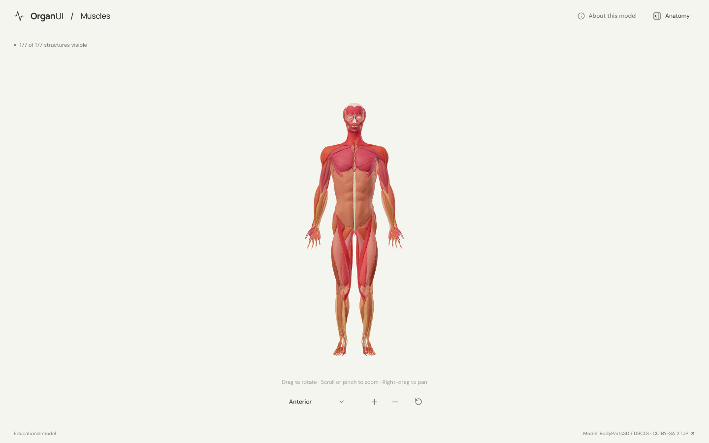
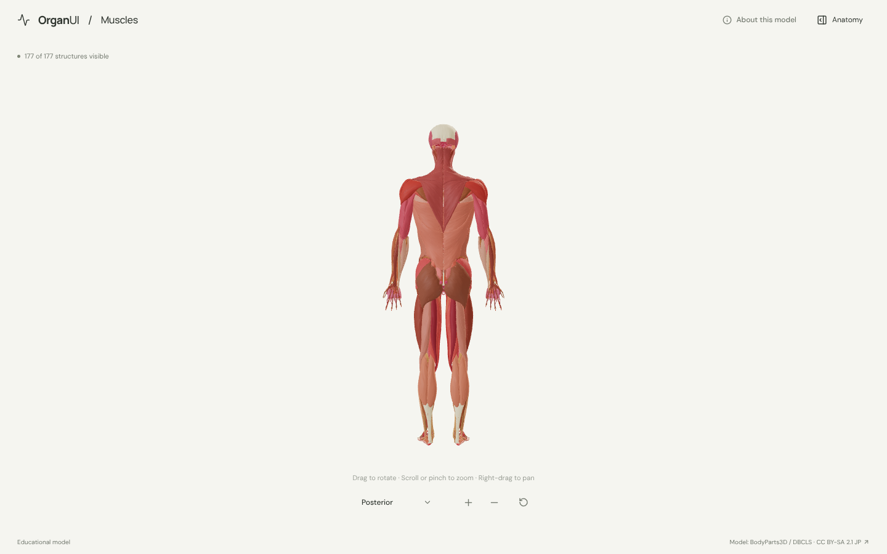
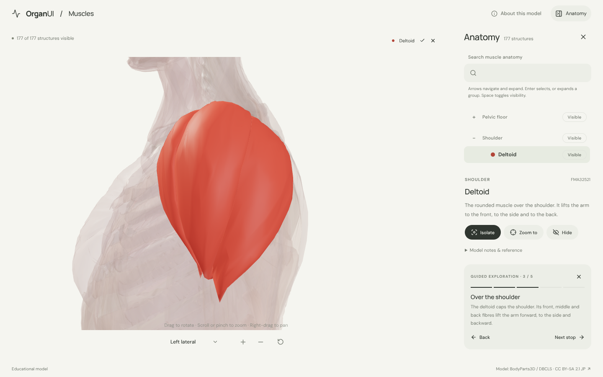
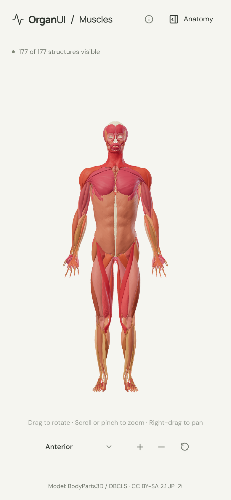
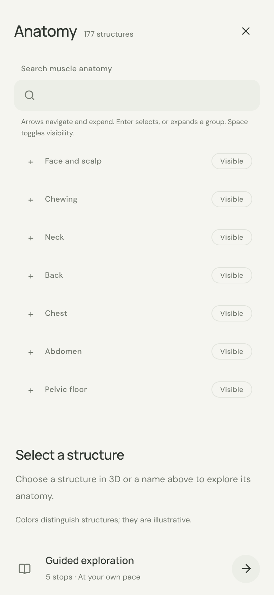

# OrganUI Muscles

A minimal, standalone, open-source explorer of the skeletal muscles of the whole body, built with React, TypeScript, Three.js, React Three Fiber, Vite, and Bun. It follows the [OrganUI Heart](https://github.com/organui/heart-3d) explorer's selection, framing, panel and toolbar behaviour.

**Status:** working local demo. 177 selectable muscles and tendons in 15 body regions, a real bundled model (5.6 MB), responsive layouts, and checked desktop/mobile interactions. Public deployment and clinical anatomy review have not been completed.



## Run locally

Install [Bun](https://bun.sh/) **1.4.2 or newer**, then:

```sh
git clone https://github.com/organui/muscles-3d.git
cd muscles-3d
bun install --frozen-lockfile
bun run dev
```

Open **http://127.0.0.1:5173**. No environment variables, accounts, API keys, sibling repositories, model downloads, or external font services are needed to run the app after dependency installation. The ready-to-use GLB is in `public/models/`.

```sh
bun run typecheck       # TypeScript checks, including conversion scripts
bun run test            # Unit tests for selection emphasis, the muscle catalogue, picking, and the anatomy-tree adapter
bun run verify:model    # Check the GLB hash, source IDs, and valid geometry
bun run build           # Typecheck and create dist/
bun run preview         # Serve the production build at http://127.0.0.1:4173
bun run format:check    # Check formatting of application and preparation code
```

The app is static and uses relative build paths. `dist/` can be hosted on any static web server; do not open `index.html` directly with `file://`. No deployment has been performed.

## Explore

- The body opens in the **anterior** view. The view menu offers anterior, posterior and left lateral presets of the whole body; manual rotation or panning changes its label to **Custom view**.
- Drag to rotate, scroll or pinch to zoom, and right-drag (or drag with two fingers) to pan. Unlike the single-organ explorers, panning and close zoom are on so a hand or the face can fill the stage.
- Open **Anatomy** from the header to browse the tree (the OrganUI registry `anatomy-tree` component). Muscles are grouped by region, from the face and scalp to the foot; regions start collapsed and expand to reveal a selection made in 3D. Selecting a muscle in 3D or in the tree keeps it solid with a soft glow and ghosts everything else. The name chip above the canvas opens the panel; Escape closes it and returns focus to the toggle.
- **Zoom to** frames the selected muscle from the current named view. Isolate a muscle, hide it, or restore all. Region rows show or hide all their muscles. **Reset explorer** restores the anterior camera, visibility, selection, tree search/expansion and tour state.
- Follow five guided stops, each framed on its muscle: the zygomaticus major, the diaphragm, the deltoid, the biceps femoris and the calcaneal (Achilles) tendon.
- Focus the model and use arrow keys to rotate, `+`/`-` to zoom. All anatomy text is available without WebGL.

<details>
<summary>Posterior view, guided exploration and mobile screenshots</summary>









</details>

## Model, credits, and review status

> BodyParts3D, © The Database Center for Life Science licensed under CC Attribution-Share Alike 2.1 Japan.

The model is a curated subset of **BodyParts3D 3.0**, taken from the STL copy in [Kevin-Mattheus-Moerman/BodyParts3D](https://github.com/Kevin-Mattheus-Moerman/BodyParts3D) at commit `f0eeb6e` on **16 October 2026**. That copy carries **CC BY-SA 2.1 Japan**, so the adapted `muscles.glb` is shared under the same license, separately from this repository's **MIT code license**. The heart, brain, liver and kidney explorers use BodyParts3D 4.0 from the official archive under CC BY 4.0; [model provenance](docs/MODEL_PROVENANCE.md) explains the difference. BodyParts3D 4.3 (used by some other explorers) has no limb, back or abdominal wall muscles, so 3.0 is the only source with the whole muscular system.

Read [model provenance and preparation](docs/MODEL_PROVENANCE.md), [asset attribution](public/models/ATTRIBUTION.md), and the [checksum manifest](public/models/manifest.json). Fonts are bundled under the SIL Open Font License; [third-party notices](public/licenses/README.md) are included in the production output.

Names were checked against the source parts list and geometry was inspected. Descriptions are short original summaries informed by the [NCI SEER Training muscular system pages](https://training.seer.cancer.gov/anatomy/muscular/). **Expert anatomical review is pending.** This is an educational interface demonstration, not a diagnostic or measurement tool.

Known limitations:

- Left and right muscles are one structure each, and muscles the source splits into heads or parts (deltoid, trapezius, triceps, masseter and others) are shown as one.
- Bones, ligaments, fascia and most tendons are not included, so muscles appear to float. Some muscles are missing from the source, among them the eye muscles and levator palpebrae, the auricular muscles, the tongue, palate, pharynx and larynx, the perineal muscles and the palmaris brevis.
- Geometry is simplified to stay within 0.8 mm of the source; the smallest muscles keep at least 240 triangles per mesh.
- This is a simplified adult male reference model, not a complete or patient-specific anatomy.
- Browser checks used headless desktop Chromium and a mobile viewport, not physical devices or a screen-reader audit.

## Reproduce the model

The runtime asset is included. To rebuild it from verified upstream inputs:

```sh
bun run prepare:model
bun run verify:model
```

This downloads 428 pinned STL files plus the parts list (about 890 MB) into ignored `.asset-cache/`, verifies their SHA-256 hashes, and exports the GLB plus manifest. Conversion combines each muscle's source meshes, welds STL vertices, simplifies within the error bound, transforms coordinates, recomputes normals and applies colors. It does not invent anatomy.

## Implementation

- `src/anatomy.ts`: regions, source-ID mappings, explanatory text, default view and guided stops.
- `src/App.tsx`: selection/visibility state and accessible interface controls.
- `src/components/ui/anatomy-tree.tsx`: OrganUI registry component installed with the shadcn CLI; tracked unmodified ([registry integration](docs/REGISTRY_INTEGRATION.md)).
- `src/anatomy-adapter.ts`: tree data, region/leaf mapping, and visibility conversion for this scene.
- `src/framing.ts`: shared framing rule, identical in every OrganUI explorer.
- `src/Viewer.tsx`, `src/ViewMenu.tsx`, `src/SceneCanvas.tsx`: loading, picking, camera controls (including framing a single muscle) and recoverable graphics failures.
- `scripts/`: pinned source inputs, reproducible conversion, and runtime validation.

## License

Original application code: [MIT](LICENSE). The anatomy model, derived model images, fonts, and icons retain their separately documented licenses.

Part of [OrganUI](https://github.com/organui).
